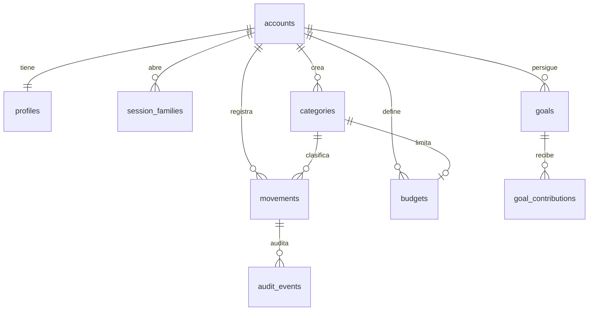

# Arquitectura de FINZA 2.0

## 1. Vista End-to-End

```mermaid
flowchart LR
  subgraph Device[Dispositivo Android / iOS]
    UI[Pantallas Expo Router<br/>(auth) · (tabs) · modales]
    DS[Sistema de diseño<br/>tokens · componentes · Monedin]
    QE[Registro rápido<br/>intérprete local es-CO]
    RTK[Redux Toolkit<br/>slice auth + RTK Query]
    SS[(SecureStore<br/>refresh token)]
    UI --> DS
    UI --> QE
    UI --> RTK
    RTK --> SS
  end
  RTK -- HTTPS JSON · Bearer JWT --> API
  subgraph Server[Backend FastAPI — monolito modular]
    API[Routers /api/v1]
    ID[identity]
    MV[movements]
    DB_[dashboard]
    BG[budgets]
    GL[goals]
    AU[audit]
    API --> ID & MV & DB_ & BG & GL
    MV --> AU
  end
  ID & MV & DB_ & BG & GL --> PG[(PostgreSQL 17<br/>Alembic 001–004)]
```

Sin servicios externos de terceros: ni IA en la nube, ni analítica, ni pasarelas.

## 2. Cliente móvil

| Aspecto | Decisión | Justificación |
|---|---|---|
| Framework | Expo SDK 58 · React Native 0.88 · TypeScript estricto | Ya establecido y probado; exigido por la guía |
| Navegación | Expo Router (archivos): grupo `(auth)` público, grupo `(tabs)` privado, modales `movement/*`, `goal/*`, `budgets` | Rutas declarativas, deep links, botón Atrás nativo; reemplaza el cambio de páginas con `useState` |
| Estado global | Redux Toolkit: slice `auth` (perfil, estado de sesión) + RTK Query para datos del servidor | Caché con invalidación por tags (`Movements`, `Dashboard`, `Budgets`, `Goals`), reset completo en logout |
| Estado local | `useState`/`useReducer` en formularios | Redux no guarda estado efímero (antiobjetivo de la especificación) |
| Sesión | Access token en memoria; refresh en SecureStore; refresh *single-flight* | Ya implementado y probado; tokens nunca en Redux |
| Diseño | `shared/theme` (tokens) + `shared/ui` (componentes) + `shared/brand` (Monedin) | Un único origen de colores, tipografía, espaciado y movimiento |
| Gráficas | `react-native-svg` propio (barras/dona) + tabla textual equivalente | Control de accesibilidad; sin librería de gráficas pesada |
| Animación | `Animated` de React Native con `useNativeDriver` + `AccessibilityInfo.isReduceMotionEnabled` | Sin dependencias nuevas; respeta Reduce Motion |
| Hápticos | `expo-haptics` en confirmaciones y errores | Feedback no visual |
| Vista web | `react-native-web` solo para QA visual en desarrollo; almacenamiento de sesión en memoria en web | Permite capturas automáticas; no es un producto web |

### Mapa de navegación

```text
/                      → redirige según sesión
(auth)/welcome         Onboarding (3 pasos con Monedin)
(auth)/login           Ingresar / Crear cuenta
(tabs)/index           Inicio: flujo neto, comparación, presupuestos, gasto por categoría, recientes
(tabs)/movements       Movimientos: mes, filtros, lista agrupada por día
(tabs)/goals           Metas de ahorro
(tabs)/profile         Perfil: cuenta, presupuestos, accesibilidad, privacidad, cerrar sesión
movement/new           Registrar (registro rápido + formulario)        [modal]
movement/[id]          Editar / archivar                               [modal]
budgets                Gestionar presupuestos por categoría
goal/new · goal/[id]   Crear meta · detalle con aportes
```

## 3. Backend

Monolito modular FastAPI. Cada módulo posee `api.py`, `schemas.py`, `service.py`, `repository.py`, `models.py`. Las reglas financieras viven en el servidor; el cliente solo formatea.

| Módulo | Responsabilidad |
|---|---|
| identity | Registro, login, refresh rotatorio, logout, `/me`, límites de intentos |
| movements | Categorías (sistema/privadas) y movimientos COP idempotentes |
| dashboard | Proyección mensual: ingresos, gastos, flujo neto, comparación, recientes, gasto por categoría |
| budgets | Límite mensual recurrente por categoría de gasto y su consumo |
| goals | Metas de ahorro y aportes (asignaciones, no alteran el flujo neto) |
| audit | Registro de cambios de movimientos en la misma transacción |

## 4. Modelo de datos



Dinero: `NUMERIC(19,4)` con CHECK de positividad, máximo y escala; moneda `CHAR(3) = 'COP'`. Fechas contables `DATE`; marcas de tiempo `TIMESTAMPTZ` UTC.

## 5. Contratos de servicio

Ver `docs/engineering/tasks/T2-backend-budgets-goals.md` para budgets/goals/desglose y `README.md` para auth/movements. Errores con formato estable `{code, message, detail, field_errors, request_id}`; 404 idéntico para recursos ajenos.

## 6. Manejo de errores y offline

- Errores de red: RTK Query expone `isError`; cada pantalla muestra estado de error con reintento y nunca presenta cifras obsoletas como actuales.
- Reintentos de creación idempotentes (`client_request_id`).
- Sin cola offline persistente (decisión de alcance documentada).
