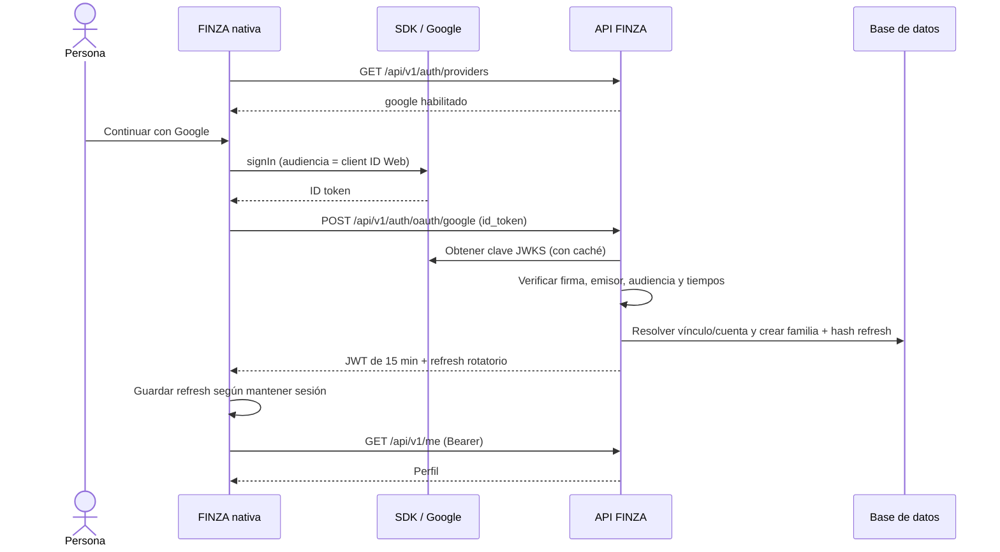
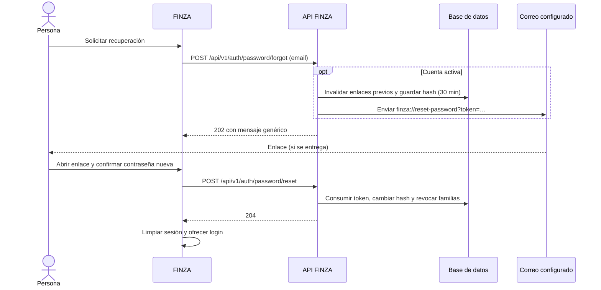

# Autenticación e identidad de FINZA

## Arquitectura

FINZA implementa autenticación propia en FastAPI/SQLAlchemy y un cliente compartido por las pantallas Expo. No delega sus sesiones a Google ni Apple. Las contraseñas se guardan con **Argon2id** (3 iteraciones, 65536 KiB, paralelismo 4), con sal gestionada por la biblioteca. Registro y contraseñas nuevas admiten 12–128 caracteres; login admite 1–128. Los correos se normalizan a minúsculas.

Cada login emite un JWT **HS256 de 15 minutos** (`iss=finza-api`, `aud=finza-mobile`, `sub` de cuenta, `sid` de familia) y un refresh opaco aleatorio. La base guarda SHA-256 del refresh, nunca su valor original. La familia vence a los **30 días del login**, sin extenderse al rotar. Cada refresh revoca el token anterior; reutilizarlo revoca toda la familia. Las rutas privadas comprueban también familia y cuenta activas, por lo que revocar invalida sus JWT pendientes. Logout revoca la familia incluso usando un refresh anterior; un token desconocido no produce error.

`AuthClient` mantiene ambos tokens en memoria y solo persiste el refresh en `finza.refresh`. En nativo usa **Expo SecureStore**, con `WHEN_UNLOCKED_THIS_DEVICE_ONLY`; en web usa un mapa en memoria, sin persistencia al recargar. Redux recibe perfil y estado de carga, nunca tokens. «Mantener la sesión iniciada» está activado por defecto: desactivarlo elimina el refresh persistido y conserva la sesión solo en memoria, sin cambiar su duración en el servidor. La restauración rota el refresh guardado y consulta `/me`; las solicitudes privadas renuevan ante un `401` y reintentan una vez. Se comparten renovaciones concurrentes y se descartan respuestas de una sesión anterior.

`SessionProvider` restaura al iniciar; al salir limpia primero la sesión y la caché local. Si falla la revocación remota o el almacenamiento, muestra ese fallo sin afirmar un cierre remoto confirmado.

Persistencia: `accounts`, `session_families`, `refresh_sessions`, `auth_buckets`, `external_identities`, `password_reset_tokens` y `email_verification_tokens`. La migración **005** permite `password_hash=NULL`, añade identidades externas únicas por `(provider, subject)` y recuperación; **006** añade confirmación y marca confirmadas las cuentas cuyo correo coincide con una identidad externa ya vinculada.

## API y límites

Prefijo **A = `/api/v1/auth`**. Los límites son contadores atómicos en base de datos, compartidos entre workers; sus claves guardan HMAC de ámbito e identificador/IP. Cada ventana empieza con el primer intento. Superarla devuelve `429` con `Retry-After` igual a la duración completa de la ventana. La IP es `request.client.host`.

Todas las rutas con cuerpo pueden devolver `422` por validación; rechazan campos extra. Donde intervienen firma, límites o Bearer, `JWT_SECRET` ausente o menor de 32 bytes produce `503`. Las rutas que usan base de datos también devuelven `503` si falta `DATABASE_URL` o falla SQLAlchemy. Las rutas de `/me` requieren `Authorization: Bearer <access_token>` y devuelven `401` sin sesión válida. La tabla recoge respuestas explícitas del código, además de esos errores comunes; no pretende enumerar todos los fallos de infraestructura.

| Método y ruta                                | Entrada / autenticación                                           | Límite                                                    | Respuestas                                                                                                                                                                                  |
| -------------------------------------------- | ----------------------------------------------------------------- | --------------------------------------------------------- | ------------------------------------------------------------------------------------------------------------------------------------------------------------------------------------------- |
| `POST A/register`                            | `email`, `password`                                               | 5/IP/hora                                                 | `201`: id, correo, moneda COP; `409`: correo registrado. Intenta enviar confirmación. No emite tokens.                                                                                      |
| `POST A/login`                               | `email`, `password`                                               | 5/IP+correo/15 min; éxito reinicia contador               | `200`: par de tokens; `401`: credenciales incorrectas o cuenta inactiva.                                                                                                                    |
| `GET A/providers`                            | Público                                                           | Sin límite explícito                                      | `200`: booleanos `google`, `apple`, `password_reset`, `email_verification`.                                                                                                                 |
| `POST A/oauth/google` o `POST A/oauth/apple` | `id_token`, `nonce` opcional                                      | 20/IP/15 min, ámbito OAuth compartido                     | `200`: par de tokens; `401`: identidad inválida; `403`: cuenta inactiva; `422`: falta correo verificado para crear/vincular; `503`: proveedor sin audiencia. Otro proveedor devuelve `404`. |
| `POST A/password/forgot`                     | `email`                                                           | 10/IP/hora y 3/correo/hora                                | `202`: mensaje genérico, exista o no cuenta activa y aunque falle la entrega.                                                                                                               |
| `POST A/password/reset`                      | `token`, `new_password`                                           | 10/IP/15 min                                              | `204`; `400`: enlace inválido, usado, vencido o cuenta inactiva.                                                                                                                            |
| `POST A/email/verify`                        | `token`, sin sesión                                               | 20/IP/15 min                                              | `204`; `400`: enlace inválido, usado, vencido o cuenta inactiva.                                                                                                                            |
| `POST A/refresh`                             | `refresh_token`                                                   | 30/familia/minuto; desconocidos comparten clave `unknown` | `200`: nuevo par; `401`: sesión inválida/expirada o replay, con revocación cuando corresponde.                                                                                              |
| `POST A/logout`                              | `refresh_token`, sin Bearer                                       | Sin límite explícito                                      | `204`, también para token desconocido.                                                                                                                                                      |
| `GET /api/v1/me`                             | Bearer                                                            | Sin límite explícito                                      | `200`: id, email, base_currency, has_password, providers, email_verified; `401`.                                                                                                            |
| `POST /api/v1/me/email/verification`         | Bearer, sin cuerpo                                                | 3/cuenta/hora                                             | `202`: mensaje con correo; `401`; `409`: ya confirmado; `503`: correo desactivado.                                                                                                          |
| `POST /api/v1/me/password`                   | Bearer, `new_password`, `current_password` si ya tiene contraseña | 5/cuenta/15 min                                           | `204`; `400`: contraseña actual incorrecta; `401`.                                                                                                                                          |

El par contiene `access_token`, `refresh_token`, `token_type=bearer` y `expires_in=900`. Los tokens de refresh, recuperación y confirmación recibidos admiten 20–256 caracteres; `id_token`, 20–8192; nonce, 8–256 cuando se envía.

## Google y Apple

`AuthScreen` consulta `/providers` y combina sus capacidades con `socialAvailability`: Google requiere plataforma nativa, client ID Web, módulo nativo y, en iOS, client ID iOS. Apple requiere iOS y `isAvailableAsync()`. Un fallo de capacidades oculta los botones. La cancelación del SDK no se muestra como error.

Google usa `@react-native-google-signin/google-signin`, solicita `email` y `profile` y obtiene un ID token; Android comprueba Google Play Services. El client ID **Web** es la audiencia solicitada, aunque la aplicación sea Android/iOS. El flujo actual **no genera ni envía nonce para Google**.

Apple usa `expo-apple-authentication`, solicita nombre y correo, genera un nonce con dos UUID aleatorios y envía **SHA-256(nonce)** al SDK; a FINZA envía el nonce original junto con `identityToken`. El nombre no forma parte del intercambio con la API.

El backend verifica firma **RS256** con JWKS públicos: Google `https://www.googleapis.com/oauth2/v3/certs`, Apple `https://appleid.apple.com/auth/keys`. Exige `iss`, `aud`, `sub`, `iat`, `exp`, valida audiencia configurada y tiempos con 30 segundos de tolerancia. Acepta emisores Google `https://accounts.google.com`/`accounts.google.com` y Apple `https://appleid.apple.com`. Si la petición o el token incluye nonce, exige coincidencia; el comparador actual acepta tanto su valor original como SHA-256, sin distinguir proveedor. Si ambos lo omiten, no exige nonce. No guarda tokens del proveedor ni necesita su client secret para esta verificación.

Reglas de identidad:

- Un vínculo `(provider, subject)` existente recupera su cuenta, sin exigir que el proveedor repita el correo.
- Sin vínculo, solo crea/vincula con correo marcado verificado (`true` o `"true"`). Si ya existe una cuenta **confirmada** con ese correo, conserva su contraseña y añade el vínculo.
- Si la cuenta existente **no estaba confirmada**, confirma el correo y, si tenía contraseña, la elimina y revoca sus familias: quien prerregistró un correo ajeno no conserva acceso después del ingreso de su dueño por el proveedor.
- Una cuenta nueva externa nace confirmada, sin contraseña, con COP/es-CO. Puede crear su primera contraseña desde Perfil sin contraseña actual; después también puede entrar por correo. Cuenta inactiva: `403`.

## Contraseñas y confirmación del correo

**Recuperación:** `(auth)/forgot.tsx` valida el correo, llama a `forgotPassword` y muestra un mensaje genérico; impone 30 segundos antes de reenviar en la interfaz. El servidor invalida enlaces anteriores y genera un token de un solo uso, almacenado como SHA-256, con **30 minutos** de vigencia. Abrir `finza://reset-password?token=…` lleva a `reset-password.tsx`: exige contraseña nueva y confirmación coincidentes. Al completar, cambia el hash, consume el token y revoca **todas** las familias, incluida la actual; la app limpia su sesión y ofrece iniciar sesión. También permite recuperar una cuenta sin contraseña. La respuesta no revela problemas de envío.

**Cambio autenticado:** `security/password.tsx` pide contraseña actual si `has_password` no es falso. El servidor la comprueba cuando existe hash, guarda el nuevo y revoca las otras familias, conservando la actual. El cliente recarga `/me`.

**Confirmación:** el registro intenta enviar un enlace si el correo está habilitado. Cada emisión invalida enlaces previos y guarda el hash de un token de un solo uso con **24 horas** de vigencia. `finza://verify-email?token=…` abre `verify-email.tsx`, que llama una vez a `verifyEmail`, incluso sin sesión. Sin token muestra fallo; si confirma, ofrece «Iniciar sesión» o «Ir al inicio» según el perfil. Con sesión, el cliente intenta recargar `/me`. La confirmación establece `email_verified_at`; no bloquea el uso previo de FINZA. El banner permite enviar/reenviar, anuncia el mensaje devuelto y «Ahora no» lo oculta durante la sesión de la app. `scheme: finza` está declarado en `mobile/app.json`; los enlaces requieren una instalación que registre ese esquema.

## Correo y variables de entorno

`smtp` envía correo de texto mediante `smtplib.SMTP`, STARTTLS por defecto y autenticación si se define usuario. `log` escribe destinatario y enlace completo en el log: solo desarrollo. Vacío, `disabled` u otro valor desactiva la entrega; `/providers` solo habilita recuperación/confirmación con `smtp` o `log`. Un `202`, y también el registro exitoso, **no certifican entrega**: los errores SMTP se registran y no se propagan al solicitante.

Los archivos versionados `backend/.env.example` y `mobile/.env.example` contienen plantillas y valores de desarrollo, **no credenciales reales configuradas**. Los valores propios de despliegue, claves, contraseñas e IDs reales se suministran fuera del repositorio. Los `EXPO_PUBLIC_*` se incluyen en el cliente y no deben contener secretos. Esta revisión no valida la configuración de ningún servidor remoto.

| Backend                   | Uso / valor por defecto en código                                                                                              |
| ------------------------- | ------------------------------------------------------------------------------------------------------------------------------ |
| `DATABASE_URL`            | Conexión SQLAlchemy; la plantilla muestra PostgreSQL local con contraseña de reemplazo.                                        |
| `JWT_SECRET`              | Firma HS256 y claves HMAC de límites; mínimo 32 bytes, sin valor inseguro por defecto.                                         |
| `FINZA_CORS_ORIGINS`      | Orígenes de la vista web de desarrollo, separados por comas.                                                                   |
| `FINZA_GOOGLE_CLIENT_IDS` | Audiencias Google aceptadas, separadas por comas; vacío deshabilita Google. Para este SDK incluir el ID Web.                   |
| `FINZA_APPLE_AUDIENCES`   | Audiencias Apple aceptadas, separadas por comas; para el flujo iOS, bundle ID. Vacío deshabilita Apple.                        |
| `FINZA_MAIL_MODE`         | `smtp`, `log` o desactivado; por defecto vacío.                                                                                |
| `FINZA_MAIL_FROM`         | Remitente autorizado por el proveedor SMTP; obligatorio en modo smtp.                                                          |
| `FINZA_SMTP_HOST`         | Servidor SMTP, obligatorio en modo smtp.                                                                                       |
| `FINZA_SMTP_PORT`         | Puerto SMTP; `587`.                                                                                                            |
| `FINZA_SMTP_USER`         | Usuario SMTP; si está vacío, no hace login SMTP.                                                                               |
| `FINZA_SMTP_PASSWORD`     | Contraseña/token SMTP; requerida cuando hay usuario.                                                                           |
| `FINZA_SMTP_STARTTLS`     | STARTTLS activo salvo valor `false` (sin distinguir mayúsculas); variable leída por código aunque no figure en `.env.example`. |
| `FINZA_RESET_LINK_BASE`   | Base de recuperación; `finza://reset-password`.                                                                                |
| `FINZA_VERIFY_LINK_BASE`  | Base de confirmación; `finza://verify-email`.                                                                                  |

| Mobile                              | Uso / plantilla                                                                                                                                                                       |
| ----------------------------------- | ------------------------------------------------------------------------------------------------------------------------------------------------------------------------------------- |
| `EXPO_PUBLIC_API_URL`               | API accesible desde el dispositivo; plantilla `http://localhost:8000`. Vacía o `auto` en desarrollo: host de Metro + `EXPO_PUBLIC_API_PORT` (8000). Sin host: `http://10.0.2.2:8000`. |
| `EXPO_PUBLIC_GOOGLE_WEB_CLIENT_ID`  | Client ID OAuth Web usado por Google como audiencia; vacío oculta Google.                                                                                                             |
| `EXPO_PUBLIC_GOOGLE_IOS_CLIENT_ID`  | Client ID OAuth iOS; requerido adicionalmente para mostrar Google en iOS.                                                                                                             |
| `EXPO_PUBLIC_GOOGLE_IOS_URL_SCHEME` | ID iOS invertido, suministrado como `iosUrlScheme` al plugin en `app.config.js`; requiere reconstruir el binario.                                                                     |

## Configurar credenciales

Pasos pendientes de ejecución con cuentas reales; no se han configurado credenciales ni validado login social o entrega SMTP en esta revisión.

### Google Cloud

1. Crear/seleccionar un proyecto en Google Cloud y configurar la pantalla de consentimiento OAuth (nombre, correo de soporte, audiencia y usuarios de prueba si corresponde). Crear las credenciales OAuth en ese proyecto. [Guía de Google](https://support.google.com/googleapi/answer/6158849).
2. Crear un cliente de tipo **Web**. Poner su ID en `EXPO_PUBLIC_GOOGLE_WEB_CLIENT_ID` y en `FINZA_GOOGLE_CLIENT_IDS`; el backend admite una lista por comas. El SDK solicita ese ID como audiencia. FINZA no consume su client secret.
3. Crear un cliente **Android** con paquete **`co.edu.unisabana.finza`** y la **SHA-1 del certificado de la clave que firma el APK instalado**. Obtenerla del keystore real (`keytool -list -v -keystore <ruta> -alias <alias>`), del informe de firma de Gradle si existe el proyecto nativo o de las credenciales de EAS. Registrar cada combinación de firma usada (desarrollo, distribución, Play App Signing si aplica); no confundir SHA-1 con SHA-256. El ID Android no reemplaza al Web en la app. [Configuración oficial del SDK](https://react-native-google-signin.github.io/docs/setting-up/get-config-file).
4. Para iOS, crear un cliente **iOS** con bundle ID **`co.edu.unisabana.finza`**. Copiar su ID a `EXPO_PUBLIC_GOOGLE_IOS_CLIENT_ID` y su esquema invertido a `EXPO_PUBLIC_GOOGLE_IOS_URL_SCHEME`. `app.config.js` ya conecta el esquema al plugin. [Plugin Expo del SDK](https://react-native-google-signin.github.io/docs/setting-up/expo).
5. Suministrar las variables al backend y al entorno de compilación móvil, reiniciar la API y reconstruir/instalar un development build con los módulos nativos. Verificar `/providers` y probar con un usuario autorizado. Configurar IDs no demuestra que el login funcione.

### Apple Developer

1. En la cuenta de Apple Developer, registrar/seleccionar el App ID explícito **`co.edu.unisabana.finza`** y habilitar **Sign in with Apple**; preparar certificados y perfil de aprovisionamiento que incluyan esa capacidad.
2. Configurar `FINZA_APPLE_AUDIENCES=co.edu.unisabana.finza` en el backend. El flujo nativo usa el bundle ID como audiencia; no requiere un Services ID web ni client secret en este código.
3. `app.config.js` ya añade `expo-apple-authentication` y `ios.usesAppleSignIn=true`. Generar una compilación propia firmada y probar en iOS compatible, verificando emisión y validación del nonce. La presencia del plugin no acredita una prueba en dispositivo. [Configuración oficial de Expo](https://docs.expo.dev/versions/latest/sdk/apple-authentication/).

### Proveedor SMTP

1. Crear una cuenta en un proveedor SMTP y autorizar/verificar dominio y remitente. Por ejemplo, Resend requiere dominio verificado y API key; permite `smtp.resend.com`, usuario `resend`, contraseña igual a la API key y puerto **587 con STARTTLS**, compatible con este mailer. [Configuración SMTP de Resend](https://resend.com/docs/send-with-smtp).
2. Suministrar `FINZA_MAIL_MODE=smtp`, `FINZA_MAIL_FROM`, `FINZA_SMTP_HOST`, `FINZA_SMTP_PORT=587`, `FINZA_SMTP_USER` y `FINZA_SMTP_PASSWORD` fuera del repositorio; mantener STARTTLS activo. Este código no implementa SMTPS implícito del puerto 465.
3. Mantener las bases `finza://reset-password` y `finza://verify-email` para la app instalada; reiniciar la API. Para desarrollo sin entrega real, usar `FINZA_MAIL_MODE=log` y leer el enlace en los logs.
4. Solicitar confirmación y recuperación con un correo controlado, comprobar recepción y abrir ambos enlaces desde la instalación propia. Validar caducidad, uso único y revocación de sesiones; un `202` no sustituye esa comprobación.

## Limitaciones conocidas

- La integración social de FINZA debe validarse en un **Expo development build propio**, no en la vista web ni tomando Expo Go como prueba de la identidad de la app. Google necesita el módulo nativo ausente en Expo Go. **Matiz:** Expo sí incluye AppleAuthentication en Expo Go, pero sus identificadores pueden diferir de los de una app independiente; no equivale a probar la audiencia/bundle ID de FINZA. El código no contiene una prohibición explícita de Expo Go para Apple. [Expo AppleAuthentication](https://docs.expo.dev/versions/latest/sdk/apple-authentication/).
- Apple solo se ofrece en iOS; Google y Apple están ocultos en web. Desde Linux no se pueden compilar iOS **localmente** ni ejecutar su simulador: hacen falta macOS/Xcode para ello y un entorno iOS para probar Apple. Sí se puede solicitar una compilación iOS en la nube desde Linux; eso no acredita pruebas locales ni en dispositivo. [Opciones de compilación de Expo](https://docs.expo.dev/develop/development-builds/introduction/).
- Las plantillas no tienen credenciales sociales reales configuradas: sin audiencias en el servidor los botones siguen ocultos; Google además exige IDs y SDK disponibles en el cliente. La entrega externa de correo también queda pendiente de configuración y prueba.
- Web conserva la sesión **solo en memoria**, incluso marcando «Mantener la sesión iniciada»; recargar la página pierde el acceso local.
- Los resultados de Jest con runtime simulado no verifican JWKS reales, credenciales OAuth, firma de builds, apertura de enlaces por el sistema operativo ni entrega de correo.

Fuentes de implementación: `backend/app/modules/identity/{api,external,passwords,verification,sessions,models,schemas,limits,tokens,dependencies,service}.py`, `backend/app/core/security.py`, `backend/app/shared/mailer.py`, migraciones 005/006; `mobile/src/features/auth/{client,social,AuthScreen,SessionProvider,storage,runtime}`, `components/VerifyEmailBanner.tsx`, rutas de recuperación/confirmación/cambio de contraseña y configuración Expo y `.env.example` de ambos proyectos.
