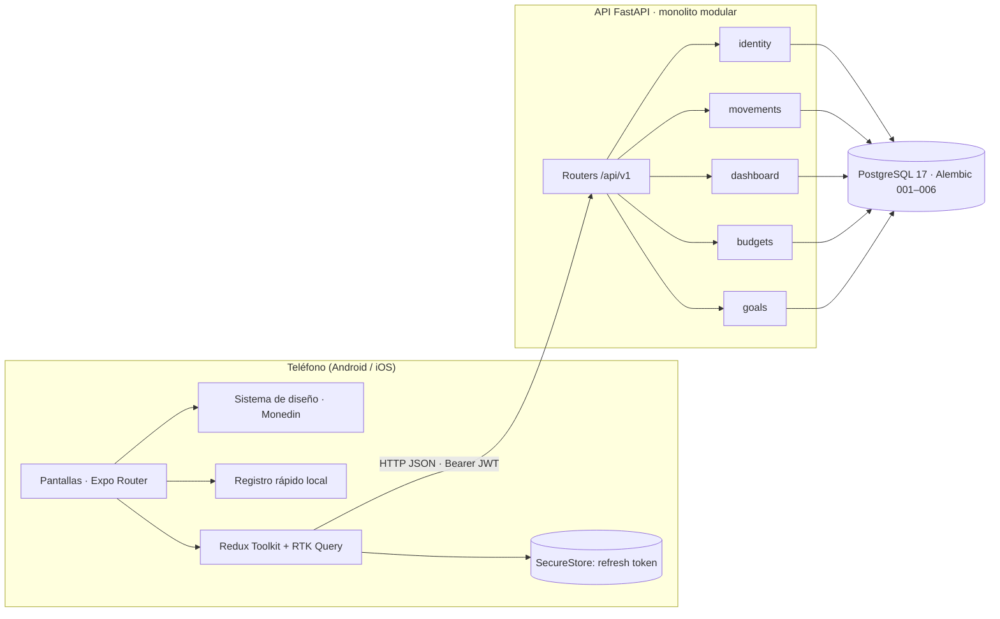
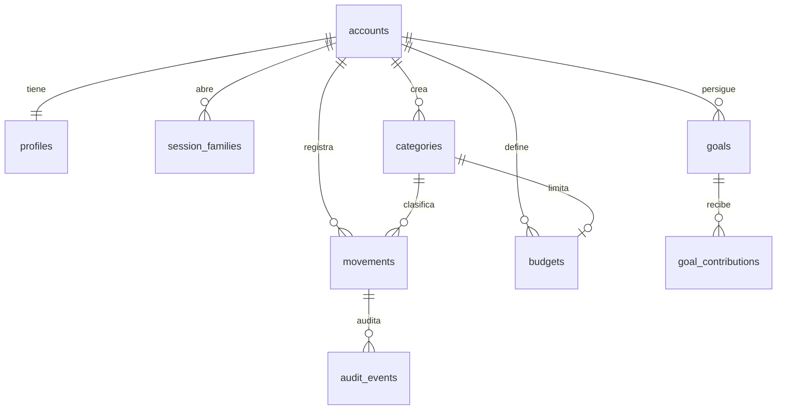

# FINZA — Documento técnico final (Fase 3)

**Asignatura:** Desarrollo de Aplicaciones Móviles · Universidad de La Sabana, Facultad de Ingeniería  
**Equipo:** Isabela Benítez, Juan David Rubio, Yeison David Niño Arias.  
**Repositorio:** https://github.com/YeisonD6/finza-2 (rama `main`)  
**Fecha:** 12 de noviembre de 2026

---

## Sección 1. Visión del producto, problema y estado del arte

### 1.1 Resumen ejecutivo y propuesta de valor

**FINZA** — _Tus cuentas claras, con Monedin a tu lado._

FINZA es una app móvil de finanzas personales en pesos colombianos para jóvenes de 18 a 30 años. Convierte un mes de ingresos y gastos en una imagen clara: ingresos, gastos, flujo neto, comparación con el mes anterior y gasto por categoría. Permite fijar presupuestos mensuales por categoría y metas de ahorro con abonos. La acompaña **Monedin**, una mascota que explica, celebra y recuerda sin infantilizar.

**Propuesta de valor (UVP):** finanzas personales claras, exactas, privadas y accesibles, con un acompañante.

| Persona                                | Contexto                             | Necesidad principal                            | Accesibilidad                                                                                   |
| -------------------------------------- | ------------------------------------ | ---------------------------------------------- | ----------------------------------------------------------------------------------------------- |
| Laura, 21, estudiante en Chía          | Mesada y trabajo de medio tiempo     | Saber cuánto le queda para comida y transporte | Usa el celular con una mano en el bus                                                           |
| Andrés, 27, analista junior en Bogotá  | Primer salario, arriendo y servicios | No pasarse del presupuesto y ahorrar           | Ninguna declarada                                                                               |
| Camila, 24, diseñadora con baja visión | TalkBack y fuente al 200 %           | Llevar sus finanzas sola                       | Lector de pantalla, contraste alto, objetivos táctiles grandes, nada que dependa solo del color |

> Las personas fueron reconstruidas por el equipo a partir del alcance de la Fase 1; no provienen de una investigación de usuarios nueva.

### 1.2 Problema y análisis competitivo

1. **Registrar es tedioso**: muchos campos y el usuario abandona en la primera semana.
2. **Los números no se entienden**: «saldo» y gráficas sin texto confunden.
3. **Se gasta sin límite consciente** y el exceso se descubre a fin de mes.
4. **Se ahorra sin objetivo** y el ahorro se diluye.
5. **Exclusión**: apps que dependen del color y de gráficas, sin soporte serio para lectores de pantalla.
6. **Desconfianza**: apps que envían los datos financieros a terceros.

|                                  | MonAi                             | Wallet (BudgetBakers)            | Monefy            | **FINZA**                                                            |
| -------------------------------- | --------------------------------- | -------------------------------- | ----------------- | -------------------------------------------------------------------- |
| Registro rápido                  | Voz + IA en la nube               | Manual o sincronización bancaria | Manual muy rápido | Texto en español interpretado **en el teléfono** («almuerzo 18 mil») |
| Presupuestos                     | Sí                                | Sí                               | Básico            | Sí, con estado en texto: al día, cerca del límite, excedido          |
| Metas de ahorro                  | No                                | Sí                               | No                | Sí, con abonos                                                       |
| Flujo neto y comparación mensual | Solo gasto                        | Sí                               | Parcial           | Sí, con reglas explícitas                                            |
| Privacidad                       | Texto enviado a proveedores de IA | Nube                             | Local / Drive     | Servidor propio, Argon2id, sesiones rotatorias, sin terceros         |
| Accesibilidad declarada          | No                                | Parcial                          | No                | WCAG 2.2 AA móvil como criterio de terminado                         |
| Moneda                           | Multimoneda                       | Multimoneda                      | Multimoneda       | COP exacto (`NUMERIC`), nunca flotantes                              |

> Wallet y Monefy se describen con conocimiento público general del equipo. Las afirmaciones sobre MonAi están en `docs/engineering/reverse-engineering-monai.md`.

### 1.3 Innovación lograda

1. **Registro rápido local y determinista** (`mobile/src/features/quick-entry/parser.ts`): entiende montos como «18 mil», «2,5 millones» o «cincuenta mil» y propone monto, fecha, tipo y categoría. No usa red ni IA externa; el usuario siempre confirma.
2. **Dinero exacto de extremo a extremo**: `NUMERIC(19,4)` en PostgreSQL, cadenas en el JSON y en la app, y registros idempotentes con `client_request_id`.
3. **Accesibilidad como requisito**: cada cifra tiene texto, la dona tiene alternativa textual y los estados de presupuesto no dependen del color.
4. **Monedin con propósito**: aparece en bienvenida, estados vacíos, confirmaciones y metas, y respeta «Reducir movimiento».

---

## Sección 2. Arquitectura e implementación técnica

### 2.1 Diagrama end-to-end



No hay servicios externos de terceros: ni IA en la nube, ni analítica, ni pasarelas de pago.

### 2.2 Decisiones arquitectónicas

| Aspecto        | Decisión                                                                                                                | Por qué                                                                                                                                 |
| -------------- | ----------------------------------------------------------------------------------------------------------------------- | --------------------------------------------------------------------------------------------------------------------------------------- |
| Cliente        | Expo SDK 58, React Native 0.88, TypeScript estricto                                                                     | Un código para Android e iOS; se prueba en Expo Go sin compilar                                                                         |
| Navegación     | Expo Router por archivos: `(auth)` público, `(tabs)` privado con 4 pestañas, modales `movement/*`, `goal/*`, `budgets`  | Rutas declarativas, botón Atrás nativo y enlaces profundos                                                                              |
| Estado global  | Redux Toolkit: slice `auth` + RTK Query para datos del servidor                                                         | Caché con invalidación por etiquetas (`Movements`, `Dashboard`, `Budgets`, `Goals`): al guardar un movimiento, Inicio se actualiza solo |
| Estado local   | `useState` / `useReducer` en formularios                                                                                | Redux no guarda estado efímero                                                                                                          |
| Sesión         | Access token en memoria; refresh token en SecureStore; refresco _single-flight_; tiempo límite de 15 s por petición     | El token nunca pasa por Redux; una sola renovación aunque fallen varias peticiones a la vez                                             |
| Rutas privadas | `PrivateScreen` redirige a login si no hay sesión                                                                       | Un enlace directo sin sesión nunca muestra datos ni errores                                                                             |
| Backend        | FastAPI + SQLAlchemy 2 + psycopg 3; cada módulo con `api`, `schemas`, `service`, `repository`, `models`                 | Reglas financieras en el servidor; el cliente solo formatea                                                                             |
| Contrato       | `openapi.json` exportado de FastAPI → `openapi-typescript` → `mobile/src/shared/api/schema.d.ts`                        | La app y la API no se desincronizan                                                                                                     |
| Rendimiento    | Lista virtualizada en Movimientos; paginación por cursor (`limit` 1–100); animaciones con el driver nativo y Reanimated | La lista no carga todo el historial y las animaciones no bloquean el hilo de JavaScript                                                 |

Estructura del proyecto (resumen):

```text
mobile/src/app/        Pantallas (cada archivo es una ruta)
mobile/src/features/   auth, dashboard, movements, quick-entry, budgets, goals, widgets
mobile/src/shared/     ui, theme, brand, api, formatting, forms, accessibility
backend/app/modules/   identity, users, movements, dashboard, budgets, goals, audit
backend/migrations/    001_identity … 006_email_verification
```

### 2.3 Modelo de datos y contratos



- Dinero: `NUMERIC(19,4)` con CHECK de positividad, máximo y escala; moneda `CHAR(3) = 'COP'`. Fechas contables `DATE` con calendario de Bogotá; marcas de tiempo `TIMESTAMPTZ` en UTC.
- Cada consulta filtra por el dueño del token. Un recurso ajeno responde el mismo 404 que uno inexistente.
- Errores con formato estable: `{code, message, detail, field_errors, request_id}`, mensajes en español.

| Flujo            | Endpoint principal                                           | Regla clave                                                                                   |
| ---------------- | ------------------------------------------------------------ | --------------------------------------------------------------------------------------------- |
| Registro / login | `POST /api/v1/auth/register`, `/auth/login`, `/auth/refresh` | Argon2id; refresh rotatorio por familia; límite de intentos                                   |
| Movimientos      | `GET/POST /api/v1/movements`, `PATCH/DELETE /movements/{id}` | Monto como cadena; `client_request_id` idempotente; DELETE archiva                            |
| Resumen del mes  | `GET /api/v1/dashboard/summary?month=YYYY-MM`                | Ingresos, gastos, flujo neto, comparación con el mes calendario anterior, gasto por categoría |
| Presupuestos     | `/api/v1/budgets`                                            | Límite mensual recurrente por categoría; estado < 80 %, 80–100 %, > 100 %                     |
| Metas            | `/api/v1/goals`, abonos                                      | Los abonos son asignaciones: no cambian el flujo neto                                         |

---

## Sección 3. Implementación y auditoría de accesibilidad

### 3.1 Semántica para lectores de pantalla

Uso medido en `mobile/src` (sin contar pruebas): `accessibilityLabel` en 39 archivos, `accessibilityRole` en 34, `accessibilityState` en 14, `accessibilityHint` en 10 e `importantForAccessibility` en 18.

- **Agrupación:** cada fila de movimiento (`shared/ui/MovementRow.tsx`) es un solo elemento con una etiqueta completa (categoría, monto en COP, fecha y tipo), para evitar focos fragmentados.
- **Decorativos ocultos:** iconos y brillos de fondo usan `importantForAccessibility="no-hide-descendants"` (`DecorativeIcon.tsx`, `Glass.tsx`).
- **Estados anunciados:** los requisitos de contraseña y el onboarding usan `accessibilityLiveRegion="polite"`; los guardados se anuncian con `shared/accessibility/announcements.ts`.
- **Carga:** los esqueletos (`Skeleton.tsx`) son un solo `progressbar` con la etiqueta «Cargando…» y estado `busy`.
- **Botones ocupados** conservan su nombre («Guardar») y exponen `busy`, en lugar de cambiar a un texto genérico.

### 3.2 Contraste, tipografía y color

Contraste calculado por luminancia relativa sobre la paleta real (`docs/engineering/design-system.md`):

| Token          | Uso                         | Claro   | Oscuro  |
| -------------- | --------------------------- | ------- | ------- |
| `ink`          | Texto principal             | 15,55:1 | 17,33:1 |
| `inkMuted`     | Texto secundario            | 6,85:1  | 8,39:1  |
| `accent`       | Acciones, pestaña activa    | 9,03:1  | 11,63:1 |
| `expense`      | Gastos y errores            | 6,32:1  | 9,62:1  |
| `progress`     | Barra de progreso (gráfico) | 3,16:1  | 6,67:1  |
| `borderStrong` | Bordes de controles         | 3,16:1  | 4,07:1  |

- Todo el texto supera 4,5:1 y los gráficos y bordes superan 3:1 (WCAG 1.4.3 y 1.4.11).
- `AppText`, `TextField` y `AmountField` usan `allowFontScaling`; solo la etiqueta de la barra de pestañas limita el escalado a 1,3× para no tapar el contenido. Los `lineHeight` están definidos en los tokens tipográficos para evitar recortes.
- **Nada depende solo del color:** gastos llevan signo y texto, los presupuestos dicen «Al día», «Cerca del límite» o «Excedido», y los banners llevan icono de éxito o de error.
- Modo claro y oscuro, con cambio de tema sin reiniciar la app.

### 3.3 Ergonomía táctil y navegación

- Botones de 52–56 dp de alto (`AppButton.tsx`) y controles con mínimo 48 dp en 11 componentes (pestañas, filas, selector de mes, acciones rápidas, campos). `hitSlop` en botones de icono.
- El gesto de deslizar para archivar tiene alternativa: abrir el movimiento y usar «Archivar», con confirmación.
- Al navegar, el foco va al título de la pantalla; tras un error, al primer campo inválido.
- Retroalimentación háptica en confirmaciones y errores (`shared/theme/haptics.ts`).
- 11 componentes consultan `useReducedMotion`: con «Reducir movimiento», Monedin, los esqueletos y las transiciones quedan quietos.

### 3.4 Matriz trazable: compromiso vs. implementación

> El documento de propuesta del segundo corte no está en el repositorio. La matriz usa los criterios de accesibilidad que el equipo fijó en `docs/architecture/technical-review.md`, que cubren los ejes de la Fase 2.

| Compromiso                                   | Implementación (archivo)                                                                                           | Validación                                               |
| -------------------------------------------- | ------------------------------------------------------------------------------------------------------------------ | -------------------------------------------------------- |
| Texto 4,5:1; gráficos 3:1                    | `shared/theme/tokens.ts`                                                                                           | Cálculo de contraste documentado en `design-system.md`   |
| Controles ≥ 48 dp                            | `AppButton.tsx`, `TabBar.tsx`, `MovementRow.tsx`, `MonthSwitcher.tsx`                                              | Pruebas de estilo en Jest                                |
| Escalado de fuente sin recorte               | `AppText.tsx`, `TextField.tsx`, `AmountField.tsx`                                                                  | Revisión manual en web; falta 1,5× y 2× en teléfono      |
| Etiquetas persistentes en formularios        | `TextField.tsx`, `FormField.tsx`                                                                                   | Pruebas de formularios (`forms.test.tsx`)                |
| Errores anunciados y foco al primer inválido | `shared/forms/useFormFeedback.ts`, `announcements.ts`                                                              | Pruebas Jest de autenticación y movimientos              |
| Sin dependencia exclusiva del color          | `BudgetProgress.tsx`, `SproutProgress.tsx`, `AmountText.tsx`, `Banner.tsx`                                         | Pruebas del sistema de diseño (`design-system.test.tsx`) |
| Alternativa al gesto                         | `MovementForm.tsx`: botón «Archivar movimiento» con confirmación                                                   | Pruebas de movimientos                                   |
| Reducir movimiento                           | `shared/theme/motion.ts`, `Skeleton.tsx`, `Monedin.tsx`                                                            | Pruebas del sistema de diseño con Reduce Motion simulado |
| Gráficas con texto equivalente               | `CategorySpending.tsx`: la dona se lee como «Gasto por categoría: Alimentación 620.000 pesos, 66,67 por ciento; …» | `Insights.test.tsx`                                      |
| Recorrido completo con TalkBack              | —                                                                                                                  | **Pendiente en teléfono real**                           |

---

## Sección 4. Pruebas y validación

### 4.1 Pruebas automáticas (12 de noviembre de 2026)

| Suite                                                          | Herramienta            | Resultado                      |
| -------------------------------------------------------------- | ---------------------- | ------------------------------ |
| API contra PostgreSQL real                                     | pytest                 | 219 pruebas pasan              |
| Estilo del backend                                             | ruff                   | Sin errores                    |
| Lógica móvil (cliente, dinero, parser, URL de la API, widgets) | node:test vía tsx      | 195 pruebas pasan              |
| Pantallas y componentes                                        | Jest + Testing Library | 144 pruebas en 22 suites pasan |
| Tipos                                                          | `tsc --noEmit`         | Sin errores                    |

GitHub Actions (`.github/workflows/quality.yml`) corre ruff, pytest, typecheck, las pruebas móviles y el export de Android en cada cambio; las dos comprobaciones pasaron en el PR #3.

### 4.2 Casos funcionales ejecutados a mano

Recorrido en la vista web (375 × 812) contra la API y PostgreSQL locales, con la cuenta demo:

| Caso                                               | Resultado observado                                                                      |
| -------------------------------------------------- | ---------------------------------------------------------------------------------------- |
| Login válido → Inicio                              | Muestra flujo neto, ingresos, gastos y comparación                                       |
| Registrar un gasto de $12.000                      | El flujo neto bajó exactamente $12.000 y apareció «Movimiento guardado»                  |
| Guardar sin categoría                              | Mensaje de validación junto al campo                                                     |
| Movimientos, Metas, Presupuestos, Perfil, Análisis | Cargan con datos reales; la dona empieza a las 12 en punto; metas con «32,5 %»           |
| Abrir Análisis por enlace directo sin sesión       | Redirige a login (antes mostraba un error)                                               |
| Servidor que no responde                           | A los 15 s aparece «El servidor no respondió a tiempo» (prueba automática)               |
| Expo Go en un teléfono en la misma red             | La app carga; el login con la detección automática de la API está pendiente de confirmar |

### 4.3 Auditoría de accesibilidad en dispositivo

- Widgets de Android probados en emulador: el botón de ocultar montos se anuncia como «Monto oculto» (`docs/engineering/widgets.md`).
- **No se ha ejecutado un recorrido completo con TalkBack ni VoiceOver en un teléfono real.** Las pruebas Jest validan roles, etiquetas y estados, pero no la pronunciación ni el orden real del foco. Las listas de verificación están en `docs/accessibility/`.

---

## Sección 5. Conclusiones, limitaciones y trabajo futuro

**Alcance logrado.** Autenticación con correo (y Google/Apple programados, ocultos sin credenciales), recuperación de contraseña y verificación de correo; movimientos COP con registro rápido local; resumen mensual con comparación y gasto por categoría; presupuestos; metas con abonos; análisis; modo claro y oscuro; Monedin animado; y widgets de Android en development build.

**Retos superados.**

- Dinero exacto en toda la cadena, sin convertir a número de punto flotante.
- Sesiones seguras con refresco _single-flight_ y tokens fuera de Redux.
- Mantener la app compatible con Expo Go mientras se agregaban Reanimated, gestos y vidrio.
- Corregir defectos que las pruebas no veían, gracias a la revisión visual en emulador y web.

**Limitaciones.**

- Falta el recorrido con TalkBack y VoiceOver en teléfono real.
- El historial de commits está desbalanceado entre integrantes.
- Sin modo sin conexión persistente.
- Los widgets de iOS están escritos pero sin compilar.
- `expo-sensors` y `expo-linear-gradient` están instaladas sin uso.

**Hoja de ruta.**

1. Auditoría completa con TalkBack y fuente al 200 %.
2. Movimientos recurrentes y exportar a CSV.
3. Modo sin conexión con cola de sincronización.
4. Widgets de iOS compilados y probados.
5. Despliegue de la API en un servidor público para usar la app fuera de la red local.

---

## Referencias

[1] W3C, «Web Content Accessibility Guidelines (WCAG) 2.2», W3C Recommendation, 2023. [En línea]. Disponible: https://www.w3.org/TR/WCAG22/

[2] Meta Platforms, «Accessibility», React Native Docs. [En línea]. Disponible: https://reactnative.dev/docs/accessibility

[3] Expo, «Expo Router», Expo Documentation. [En línea]. Disponible: https://docs.expo.dev/router/introduction/

[4] Redux, «RTK Query: Cache Behavior», Redux Toolkit Docs. [En línea]. Disponible: https://redux.js.org/toolkit/rtk-query/usage/cache-behavior

[5] S. Ramírez, «FastAPI», documentación oficial. [En línea]. Disponible: https://fastapi.tiangolo.com/

[6] OWASP Foundation, «Password Storage Cheat Sheet». [En línea]. Disponible: https://cheatsheetseries.owasp.org/cheatsheets/Password_Storage_Cheat_Sheet.html

[7] Python Software Foundation, «decimal — Decimal fixed point and floating point arithmetic». [En línea]. Disponible: https://docs.python.org/3/library/decimal.html
