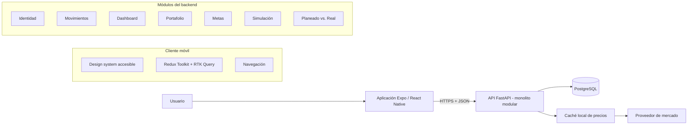

# Finza MVP - Diseño de arquitectura

**Estado:** Aprobado conceptualmente; precisado por [revisión técnica vinculante](../../architecture/technical-review.md). Implementación inicial autorizada.  
**Fecha:** 2026-10-30  
**Alcance:** MVP completo del semestre; primera entrega funcional con autenticación, dashboard y movimientos  
**Equipo:** Tres integrantes

## 1. Intención

Finza es una aplicación móvil de finanzas personales que conecta la situación actual del usuario con sus inversiones, metas, simulaciones y resultados reales. La arquitectura debe permitir entregar valor desde el primer corte y crecer durante el semestre sin una reestructuración general.

La primera sección vertical será:

1. Registro e inicio de sesión.
2. Dashboard del mes actual.
3. Registro y consulta de ingresos y gastos.
4. Recorrido accesible completo validado inicialmente con TalkBack y preparado semánticamente para VoiceOver.

Las siguientes entregas incorporarán portafolio, metas, simulaciones y Planeado vs. Real sobre los mismos límites arquitectónicos.

## 2. Objetivos, no objetivos y antiobjetivos

### Objetivos

- Entregar una aplicación móvil para iOS y Android con React Native, TypeScript y Expo.
- Usar un backend en Python con una API REST documentada y una base de datos PostgreSQL.
- Organizar frontend y backend por funcionalidades del negocio, no solo por tipos técnicos.
- Aislar los datos de cada usuario y tratar la información financiera como sensible.
- Representar dinero y cálculos financieros sin errores de coma flotante.
- Incluir accesibilidad WCAG 2.2 AA en la definición de terminado de cada flujo.
- Permitir que tres integrantes comprendan, prueben y expliquen cada módulo.
- Agregar nuevas funcionalidades sin modificar los límites de los módulos ya entregados.

### No objetivos del MVP

- Ejecutar inversiones, custodiar dinero o conectarse directamente a bancos y brokers.
- Dar recomendaciones de compra o prometer rendimientos.
- Implementar microservicios, CQRS, event sourcing o una plataforma de mensajería distribuida.
- Proporcionar datos de mercado intradía.
- Construir una aplicación web paralela.
- Implementar inteligencia artificial generativa o predicción financiera.

### Antiobjetivos

El proyecto se considerará mal diseñado aunque funcione si:

- Las pantallas llaman directamente a PostgreSQL o contienen reglas financieras.
- Se usa Redux como almacenamiento de todo estado local o efímero.
- `shared` se convierte en un depósito de lógica perteneciente a módulos concretos.
- Un endpoint puede acceder a recursos de otro usuario cambiando un identificador.
- Los gráficos son la única forma de conocer un valor o una tendencia.
- Se crean abstracciones, interfaces o eventos sin un caso de uso actual que los necesite.
- Se pospone accesibilidad para el final del semestre.

## 3. Restricciones

- El equipo está compuesto por tres personas y el proyecto debe ser defendible académicamente.
- El MVP debe poder completarse durante un semestre mediante entregas incrementales.
- Los datos iniciales serán manuales; integraciones externas son posteriores.
- El idioma principal será español y la moneda base del primer corte será obligatoriamente COP.
- El esquema conserva un código ISO 4217 por registro para admitir multimoneda después, pero el primer corte rechazará cualquier moneda distinta de COP y no realizará conversiones.
- La conformidad WCAG 2.2 AA es un objetivo verificable; no se declarará cumplimiento sin auditoría.
- El backend se desplegará como una sola aplicación y usará una sola base de datos.
- La validación manual inicial se realizará en Android con TalkBack. Las pruebas con VoiceOver y Accessibility Inspector se planificarán cuando el equipo tenga acceso a dispositivos Apple y no se reportarán como ejecutadas antes de contar con evidencia real.

## 4. Enfoques considerados

### A. Monolito tradicional por capas

Organiza todo el backend en carpetas globales de controladores, servicios y repositorios. Es rápido para iniciar, pero las reglas de movimientos, portafolio y planeación terminan mezcladas y hacen costosa la evolución.

### B. Monolito modular por funcionalidades

Cada capacidad del negocio posee sus rutas, servicios, modelos y pruebas. Los módulos se despliegan juntos y comparten PostgreSQL, pero no acceden directamente a los detalles internos de otros módulos. Este enfoque reduce operación y conserva límites claros.

### C. Arquitectura hexagonal/DDD completa

Introduce puertos, adaptadores, agregados y eventos en todos los módulos. Aísla muy bien el dominio, pero agrega demasiada ceremonia para tres integrantes y un semestre.

### Decisión

Se adopta **B: monolito modular por funcionalidades**, con principios hexagonales selectivos en los lugares donde exista una dependencia reemplazable o una regla compleja:

- Proveedor externo de precios.
- Persistencia de datos financieros.
- Servicio de tokens y contraseñas.
- Motor de simulación.
- Generación de insights.

No se crean puertos o adaptadores para operaciones CRUD simples si una separación por servicio y repositorio ya resulta clara.

## 5. Vista general



### Flujo de dependencias

```text
Pantalla móvil
  -> hook/caso de uso de la funcionalidad
  -> endpoint RTK Query
  -> API REST
  -> servicio de aplicación del módulo
  -> repositorio o puerto
  -> PostgreSQL o adaptador externo
```

Las reglas financieras viven en el backend. El cliente puede calcular valores puramente visuales, pero no decide patrimonio, rendimiento, progreso o resultados de simulación.

## 6. Organización del repositorio

```text
finza/
  mobile/                    # Aplicación Expo / React Native
  backend/                   # API FastAPI
  docs/
    architecture/            # Diagramas, ADR y contratos explicados
    accessibility/           # Auditorías y evidencias
    superpowers/             # Diseño y planes de implementación
  infra/
    compose.yaml             # PostgreSQL y API para desarrollo
  .github/workflows/         # Calidad y pruebas en CI
  README.md                  # Preparación, comandos y recorrido del proyecto
```

La raíz coordina el producto, pero cada aplicación administra sus dependencias. No se intenta compartir código entre Python y TypeScript; el contrato compartido es OpenAPI.

## 7. Arquitectura del frontend

### Tecnologías

- Expo y React Native con TypeScript estricto.
- Expo Router para navegación basada en archivos.
- Redux Toolkit para estado global del cliente.
- RTK Query para comunicación, caché y revalidación de la API.
- React Hook Form y validación de esquemas para formularios.
- `react-native-svg` para visualizaciones accesibles acompañadas por texto o tabla.
- SecureStore para refresh tokens y datos de sesión que requieran almacenamiento seguro.

Las versiones exactas se fijarán al crear el proyecto y se actualizarán de forma deliberada, no automática.

### Estructura propuesta

```text
mobile/
  app/                       # Rutas y layouts de Expo Router
  src/
    app/
      providers/             # Store, tema, accesibilidad y sesión
      store.ts
    features/
      auth/
        api/
        components/
        hooks/
        screens/
        validation/
      movements/
      dashboard/
      portfolio/             # Se crea cuando inicie esta entrega
      goals/
      simulations/
      planned-vs-actual/
    shared/
      api/                    # Base query, errores y tipos generados
      ui/                     # Componentes del design system
      accessibility/         # Utilidades de foco y anuncios
      formatting/            # Moneda, fecha y porcentajes
      config/
    test/
```

Los directorios de funcionalidades futuras no se crean vacíos. La estructura está preparada porque las reglas de importación y los contratos ya indican dónde deben agregarse.

### Redux Toolkit frente a React Context

**Redux Toolkit será la solución principal** porque Finza tendrá estado compartido, peticiones asíncronas, invalidación de caché, filtros y datos consumidos por varias pantallas.

- **RTK Query:** datos del servidor como dashboard, movimientos, portafolio, metas y simulaciones guardadas.
- **Slices Redux:** sesión en memoria, filtros globales que sobrevivan a la navegación y preferencias explícitamente globales.
- **Estado local:** campos de formulario, visibilidad de modales, acordeones y selección temporal.
- **React Context:** tema, idioma y preferencias de presentación/accesibilidad que no necesiten la maquinaria de Redux.

Esta división evita tanto el exceso de proveedores Context como el uso de Redux para detalles de una sola pantalla.

### Contrato con el backend

FastAPI publica OpenAPI. El frontend genera tipos TypeScript desde ese contrato y escribe endpoints RTK Query pequeños y explícitos. La generación comparte nombres y estructuras, pero no sustituye la revisión de UX ni expone modelos internos de base de datos.

### Navegación

- Grupo público: bienvenida, registro e inicio de sesión.
- Grupo privado: dashboard, movimientos y módulos posteriores.
- La decisión de acceso se basa en el estado de sesión; no se duplican comprobaciones en cada pantalla.
- Los deep links deben pasar primero por validación de sesión y autorización del recurso.

## 8. Arquitectura del backend

### Tecnologías

- Python y FastAPI.
- Pydantic para contratos de entrada y salida.
- SQLAlchemy 2 para persistencia.
- Alembic para migraciones.
- PostgreSQL.
- Pytest para pruebas unitarias, de integración y de seguridad.

### Estructura propuesta

```text
backend/
  app/
    main.py
    core/
      config.py
      database.py
      errors.py
      logging.py
      security.py
    modules/
      identity/
        api.py
        schemas.py
        service.py
        models.py
        repository.py
      users/
      movements/
      dashboard/
      portfolio/
      goals/
      simulations/
      planned_vs_actual/
      market_data/
      insights/
      audit/
    shared/
      money.py
      pagination.py
      time.py
  migrations/
  tests/
    unit/
    integration/
    security/
```

Los módulos futuros se incorporarán cuando comience su entrega; no se dejan paquetes vacíos.

### Capas internas de un módulo

Cada módulo puede contener:

1. **API:** traduce HTTP y valida contratos.
2. **Aplicación/servicio:** coordina el caso de uso y la transacción.
3. **Dominio:** reglas puras cuando la funcionalidad las necesita.
4. **Infraestructura/repositorio:** SQLAlchemy o integraciones externas.

Un CRUD sencillo puede omitir un archivo de dominio. Simulaciones, rendimiento y Planeado vs. Real sí tendrán funciones de dominio puras y exhaustivamente probadas.

### Reglas de dependencia

- `api.py` puede depender de `service.py` y `schemas.py`.
- `service.py` puede depender del dominio y de interfaces de repositorio.
- El dominio no importa FastAPI, SQLAlchemy ni Pydantic.
- Un módulo no consulta directamente las tablas privadas de otro desde sus rutas.
- Los módulos colaboran mediante servicios de aplicación o consultas de lectura documentadas.
- `shared` contiene únicamente primitivas realmente transversales: dinero, tiempo, paginación y errores base.

### Módulos y responsabilidades

| Módulo | Responsabilidad | No debe hacer |
|---|---|---|
| `identity` | Registro, login, refresh, logout, contraseñas y sesiones | Gestionar movimientos o perfiles financieros |
| `users` | Perfil, moneda base y preferencias | Guardar credenciales |
| `movements` | Ingresos, gastos, categorías y consulta mensual | Calcular posiciones de inversión |
| `dashboard` | Construir vistas agregadas de lectura | Ser dueño de datos financieros |
| `portfolio` | Activos, posiciones, aportes, retiros, valoración y rendimiento | Obtener precios sin pasar por `market_data` |
| `market_data` | Precios manuales, caché y adaptador de proveedor | Decidir reglas del portafolio |
| `goals` | Objetivos, fechas, montos y progreso | Ejecutar simulaciones |
| `simulations` | Escenarios y cálculo financiero reproducible | Recomendar activos |
| `planned_vs_actual` | Comparar planes y resultados observados | Modificar movimientos o posiciones |
| `insights` | Frases descriptivas basadas en reglas | Generar recomendaciones financieras |
| `audit` | Eventos de seguridad y cambios relevantes sin datos sensibles | Almacenar secretos o montos completos en logs |

`dashboard` y `planned_vs_actual` son módulos de lectura/orquestación. Pueden usar consultas optimizadas documentadas, pero no se convierten en propietarios de las tablas que leen.

## 9. Modelo de datos

### Convenciones

- Identificadores UUID.
- Fechas y horas almacenadas en UTC.
- `NUMERIC(19,4)` para dinero y `NUMERIC` con escala explícita para tasas.
- Código ISO 4217 de tres caracteres para moneda.
- `created_at` y `updated_at` en entidades editables.
- Restricciones y claves foráneas en la base de datos además de validación de aplicación.
- Borrado físico solo donde no afecte trazabilidad; los eventos financieros importantes se anulan o archivan según el caso de uso.

### Tablas de la primera entrega

| Tabla | Campos principales | Propósito |
|---|---|---|
| `accounts` | `id`, `email`, `password_hash`, `status`, timestamps | Credenciales y estado de identidad; propiedad de `identity` |
| `user_profiles` | `account_id`, `base_currency`, `locale`, timestamps | Preferencias del usuario; propiedad de `users` |
| `refresh_sessions` | `id`, `account_id`, `token_hash`, `expires_at`, `revoked_at`, metadatos mínimos | Rotación y revocación de sesión |
| `categories` | `id`, `owner_id` nullable, `name`, `movement_type`, `is_system` | Categorías del sistema y personalizadas |
| `movements` | `id`, `owner_id`, `type`, `amount`, `currency`, `occurred_on`, `category_id`, `note`, `deleted_at`, timestamps | Ingresos y gastos manuales con archivo lógico |
| `audit_events` | `id`, `actor_id`, `event_type`, `resource_type`, `resource_id`, `occurred_at` | Trazabilidad sin copiar datos sensibles |

Todas las consultas de recursos privados incluyen `owner_id` como parte de la condición, no como comprobación posterior.

### Tablas de entregas posteriores

| Módulo | Tablas previstas |
|---|---|
| Portafolio | `assets`, `portfolios`, `positions`, `portfolio_transactions`, `asset_prices` |
| Metas | `goals`, `goal_contributions`, `goal_plan_links` |
| Simulaciones | `simulation_scenarios`, `simulation_assumptions`, `simulation_results` |
| Planeado vs. Real | `monthly_plans`, `planned_contributions`, `monthly_snapshots` |

Se separan movimientos personales de transacciones de inversión: comparten conceptos monetarios, pero tienen reglas y ciclos de vida distintos. Planeado vs. Real consume ambos sin convertirlos en una tabla universal difícil de mantener.

### Moneda

El usuario tendrá una moneda base y el primer corte fija COP. Cada registro incluye desde el inicio su código de moneda, pero la API valida `currency = COP`; esto prepara el contrato y el esquema sin introducir todavía tasas ni montos normalizados. Cuando se habilite multimoneda, una migración agregará la tasa aplicada, la fecha de conversión y el monto normalizado, y un puerto de tipos de cambio suministrará la conversión. El sistema nunca sumará monedas distintas silenciosamente.

## 10. API REST

### Convenciones

- Prefijo `/api/v1`.
- JSON con nombres consistentes en `snake_case`.
- Paginación por cursor o parámetros documentados para listas extensas.
- Errores con forma estable: `code`, `message`, `field_errors` y `request_id`.
- Respuestas de dominio, no filas SQL serializadas.
- OpenAPI constituye el contrato verificable entre backend y móvil.

### Primera entrega

```text
POST   /api/v1/auth/register
POST   /api/v1/auth/login
POST   /api/v1/auth/refresh
POST   /api/v1/auth/logout
GET    /api/v1/me

GET    /api/v1/categories
GET    /api/v1/movements
POST   /api/v1/movements
GET    /api/v1/movements/{movement_id}
PATCH  /api/v1/movements/{movement_id}
DELETE /api/v1/movements/{movement_id}

GET    /api/v1/dashboard/summary?month=YYYY-MM
GET    /health/live
GET    /health/ready
```

El resumen del dashboard devuelve para el mes solicitado: total de ingresos, total de gastos, flujo neto, comparación porcentual y absoluta del flujo neto frente al mes calendario anterior, y los cinco movimientos activos más recientes. Cuando no exista un mes anterior comparable, la tendencia será `not_available` y el texto lo explicará sin inventar un porcentaje. No devuelve detalles visuales específicos; el móvil decide cómo presentarlos de forma accesible.

`DELETE /movements/{movement_id}` realiza archivo lógico mediante `deleted_at`, emite un evento de auditoría y deja de incluir el movimiento en listados y agregados. No se implementa restauración en la interfaz del primer corte, pero la información permanece disponible para trazabilidad y una futura recuperación controlada.

## 11. Seguridad y privacidad

### Autenticación

- Email normalizado y contraseña.
- Hash de contraseñas con Argon2id.
- Access token JWT de corta duración mantenido en memoria.
- Refresh token aleatorio, rotado y guardado en SecureStore; el backend conserva únicamente su hash.
- Revocación de refresh sessions en logout y ante reutilización detectada.
- Mensajes de login genéricos para evitar enumeración de usuarios.

### Autorización

- Cada servicio recibe el usuario autenticado desde una dependencia central.
- El propietario forma parte de la consulta (`id` + `owner_id`).
- Las pruebas negativas intentan leer, editar y eliminar recursos de otro usuario.
- En el MVP existe un solo rol de usuario; no se construye administración sin requisito.

### Protección de aplicación y datos

- HTTPS fuera del desarrollo local.
- CORS restringido por ambiente.
- Validación y límites de tamaño en todas las entradas.
- Rate limiting en registro, login y refresh.
- Secretos fuera del repositorio y configuración validada al iniciar.
- Migraciones versionadas y copias de seguridad en el entorno desplegado.
- Logs estructurados sin contraseñas, tokens, notas privadas ni montos completos.
- Dependencias revisadas y análisis automático de vulnerabilidades en CI.
- Cálculos monetarios con `Decimal`, nunca `float`.

El proyecto usará OWASP ASVS como checklist. No se afirma que una herramienta automática demuestre seguridad.

## 12. Accesibilidad e inclusión

La accesibilidad es transversal y forma parte de cada historia y revisión de código.

### Design system accesible

Los componentes compartidos incorporarán semántica y comportamiento seguros por defecto:

- `AppButton` y `IconButton` con rol, label, hint opcional y objetivo mínimo de 44 x 44 puntos.
- `FormField` con etiqueta persistente, ayuda, error asociado y conservación del valor válido.
- `AmountInput` que anuncia moneda y valor.
- `AccessibleCard` solo será interactiva cuando tenga una acción clara.
- `ProgressBar` expondrá nombre, mínimo, máximo y valor textual.
- `DataChart` exigirá resumen textual y alternativa tabular cuando el detalle sea material.
- `Screen` manejará título accesible y restauración lógica del foco.

### Criterios mínimos

- Contraste 4.5:1 para texto normal y 3:1 para texto grande y gráficos relevantes.
- Ningún estado depende únicamente del color; incluye signo, texto o icono.
- Dynamic Type y tamaño de fuente de Android probados aproximadamente a 1.5x.
- Layouts flexibles sin alturas fijas que recorten contenido esencial.
- Reduce Motion elimina animación decorativa y conserva feedback imprescindible.
- TalkBack recorre el flujo inicial en un orden comprensible. La semántica se implementa con APIs compatibles con Android e iOS para preparar VoiceOver sin afirmar validación manual en hardware no disponible.
- Los errores explican qué ocurrió, dónde y cómo corregirlo; se anuncian y reciben foco lógico.
- Gestos complejos nunca son la única forma de una acción crítica.
- Cambios relevantes como guardado, error o recálculo se anuncian sin producir ruido constante.

### Flujo de referencia del primer corte

`Dashboard -> Registrar movimiento -> Validar -> Guardar -> Confirmar -> Regresar al punto lógico` se prueba en happy path y sin monto. La prueba negativa debe conservar los demás datos, anunciar el error y permitir recuperación.

### Evidencia

- Pruebas de componentes del design system.
- Checklist de Dashboard y Registrar movimiento.
- Capturas de Accessibility Scanner y recorrido manual con TalkBack en el primer corte.
- Capturas de Accessibility Inspector y recorrido con VoiceOver cuando el equipo tenga acceso real a un dispositivo Apple; mientras tanto se registran como pruebas planificadas, no ejecutadas.
- Registro de hallazgos con severidad, responsable y estado.
- Video corto y reflexión académica sobre decisiones y trade-offs.

## 13. Manejo de errores y observabilidad

- Un middleware asigna `request_id` a cada petición.
- Los errores conocidos se traducen a códigos estables; los inesperados no revelan trazas al cliente.
- Logs estructurados registran módulo, acción, resultado, duración y `request_id`.
- `/health/live` indica que el proceso responde; `/health/ready` comprueba dependencias necesarias.
- Métricas avanzadas y trazas distribuidas se agregan solo si el despliegue o la evaluación las exige.
- En el móvil, los errores de red ofrecen reintento y conservan los datos del formulario cuando es seguro.

## 14. Estrategia de pruebas

### Backend

- Pruebas unitarias para reglas financieras y servicios.
- Pruebas de integración con PostgreSQL para repositorios y migraciones.
- Pruebas de API para contratos y códigos de error.
- Pruebas de seguridad para aislamiento por propietario, expiración, revocación y reutilización de refresh tokens.
- Casos conocidos de dinero, redondeo, fechas y límites de mes.

### Frontend

- Pruebas unitarias para formateo, validación y reducers.
- Pruebas de componentes para estados normal, error, loading y escalado de texto.
- Pruebas de integración de los flujos principales con API simulada.
- Comprobaciones de propiedades de accesibilidad en componentes.
- Pruebas manuales en Android con TalkBack para cada corte inicial.
- Pruebas de compatibilidad semántica y layout para iOS desde el inicio, con validación manual de VoiceOver y Accessibility Inspector programada según disponibilidad real de hardware Apple.

### Contrato y extremo a extremo

- La generación de tipos falla en CI si el contrato OpenAPI no es válido.
- Un recorrido E2E mínimo cubre registro, login, creación de movimiento y actualización del dashboard.
- No se depende únicamente de snapshots; las pruebas afirman resultados observables.

## 15. Entornos y entrega

- **Local:** Expo en dispositivo/emulador, API y PostgreSQL mediante Compose.
- **Pruebas:** base de datos aislada y reiniciable.
- **Staging:** API y base separadas con datos ficticios.
- **Producción académica:** entorno independiente con HTTPS y secretos administrados.

CI ejecutará formato, lint, typecheck, pruebas, validación de migraciones y revisión de dependencias. El despliegue automático se agrega después de estabilizar la primera sección vertical; no es requisito para comenzar el dominio.

## 16. Desarrollo incremental

### Fase 0 - Fundaciones

- Repositorio, configuración, CI, Compose y convenciones.
- Design system accesible mínimo.
- Esqueleto FastAPI, PostgreSQL, migraciones y formato de errores.
- Contrato OpenAPI y generación de tipos.

### Fase 1 - Identidad

- Registro, login, refresh y logout.
- Sesión móvil segura.
- Aislamiento de rutas privadas y pruebas negativas.

### Fase 2 - Primer corte funcional

- Categorías, creación/listado/edición de movimientos.
- Dashboard mensual con balance y últimos movimientos.
- Flujo accesible Dashboard -> Registrar movimiento.
- Auditoría y evidencia del primer corte.

### Fase 3 - Portafolio

- Activos, transacciones, posiciones y precios manuales.
- Adaptador de precios con caché para una lista limitada.
- Separación entre capital aportado y ganancia/pérdida.

### Fase 4 - Metas y simulación

- Metas con monto, fecha y progreso.
- Escenarios conservador, esperado y optimista.
- Fórmulas puras, supuestos visibles y avisos educativos.

### Fase 5 - Planeado vs. Real

- Plan mensual, snapshots y comparación.
- Integración de movimientos, portafolio, metas y escenarios mediante servicios de lectura.
- Insights descriptivos basados en reglas.

### Fase 6 - Consolidación

- Rendimiento, seguridad, auditoría de accesibilidad y pruebas E2E.
- Importación CSV o modo oscuro solo si el Must Have está estable.
- Documentación, demostración y defensa académica.

Cada fase termina en software ejecutable y evaluable; no se desarrolla una capa completa de todos los módulos antes de obtener un recorrido funcional.

## 17. Organización del equipo

- El trabajo se divide por secciones verticales, no en una persona exclusivamente de frontend, otra de backend y otra de base de datos.
- Cada sección tiene un responsable principal, un revisor y una persona que valida el recorrido accesible o la prueba negativa.
- Los roles rotan para que los tres integrantes puedan explicar frontend, API y datos.
- Los cambios son pequeños, revisables y acompañados por prueba y documentación de la decisión relevante.

### Definición de terminado

Una funcionalidad está terminada cuando:

1. Cumple los criterios funcionales y de accesibilidad.
2. Incluye happy path y fallo controlado.
3. No rompe el contrato OpenAPI ni migraciones previas.
4. Pasa lint, typecheck y pruebas.
5. Fue revisada por otro integrante.
6. Explica cualquier decisión arquitectónica nueva mediante un ADR corto.
7. Puede demostrarse con datos de prueba reproducibles.

## 18. Decisiones arquitectónicas y justificación

| ID | Decisión | Justificación |
|---|---|---|
| ADR-001 | Monolito modular | Reduce operación y conserva límites adecuados para tres personas |
| ADR-002 | FastAPI y Python | API tipada, documentación OpenAPI y buen soporte para reglas y pruebas financieras |
| ADR-003 | PostgreSQL | Consistencia, relaciones, restricciones y transacciones para datos financieros |
| ADR-004 | Redux Toolkit + RTK Query | Estado compartido y datos asíncronos predecibles sin proveedores Context anidados |
| ADR-005 | Context solo para presentación | Tema, idioma y preferencias cambian poco y no necesitan Redux completo |
| ADR-006 | OpenAPI como contrato | Evita duplicación manual de tipos entre Python y TypeScript |
| ADR-007 | `Decimal` / `NUMERIC` | Evita errores binarios de `float` en dinero y rendimiento |
| ADR-008 | Módulos futuros bajo demanda | Mantiene la arquitectura preparada sin crear código vacío o especulativo |
| ADR-009 | Hexagonal selectiva | Aísla proveedores y cálculos complejos sin imponer interfaces a todo CRUD |
| ADR-010 | Accesibilidad en design system y DoD | Previene que la semántica dependa de correcciones tardías pantalla por pantalla |
| ADR-011 | Movimientos y transacciones de inversión separados | Sus reglas son distintas; los módulos de lectura pueden combinarlos sin una tabla universal |
| ADR-012 | Tokens de acceso en memoria y refresh rotado | Reduce exposición persistente y permite revocar sesiones móviles |
| ADR-013 | Identidad y perfil en tablas separadas | Mantiene credenciales bajo `identity` y preferencias bajo `users` sin mezclar propietarios de datos |
| ADR-014 | Archivo lógico de movimientos | Preserva trazabilidad financiera y evita que una eliminación accidental altere la evidencia histórica de forma irreversible |
| ADR-015 | Dashboard comparado con el mes anterior | Proporciona una tendencia comprensible y verificable sin introducir presupuestos antes de Planeado vs. Real |
| ADR-016 | COP obligatorio en el primer corte | Evita conversiones incompletas mientras el código ISO por registro mantiene el esquema preparado para multimoneda |
| ADR-017 | TalkBack como evidencia manual inicial | Permite validar accesibilidad con hardware disponible y conserva honestidad académica sobre pruebas Apple pendientes |

## 19. Supuestos decididos por el diseño

- El MVP usa email y contraseña; proveedores sociales no forman parte del semestre.
- Existe un único tipo de usuario final y no se crea panel administrativo.
- COP es la única moneda aceptada en el primer corte; el modelo conserva el campo ISO 4217 para la futura evolución.
- No se suman monedas sin conversión explícita y no se crean tasas ficticias para aparentar soporte multimoneda.
- TalkBack y Android constituyen la validación manual inicial. VoiceOver y Accessibility Inspector permanecen en el plan hasta disponer de hardware Apple y evidencia verificable.
- El primer corte usa categorías de sistema y permite añadir categorías propias solo si el cronograma lo permite.
- Los anuncios, si se incorporan, serán un componente visual aislado y rotulado; no se personalizan con datos financieros.
- Eliminar un movimiento significa archivarlo lógicamente; el primer corte no incluye una pantalla de restauración.
- El dashboard del primer corte compara el flujo neto con el mes calendario anterior y presenta los cinco movimientos activos más recientes.

## 20. Criterio de aprobación

Este diseño queda aprobado cuando el equipo confirma:

1. Los límites de los módulos.
2. FastAPI + PostgreSQL para backend y datos.
3. Redux Toolkit + RTK Query como estrategia principal de estado.
4. Context limitado a presentación y accesibilidad.
5. La secuencia incremental de fases.
6. Accesibilidad, seguridad y pruebas como parte de la definición de terminado.

Después de la aprobación se elaborará el plan de implementación detallado del primer corte, con archivos, interfaces, pruebas, comandos y entregables pequeños.
